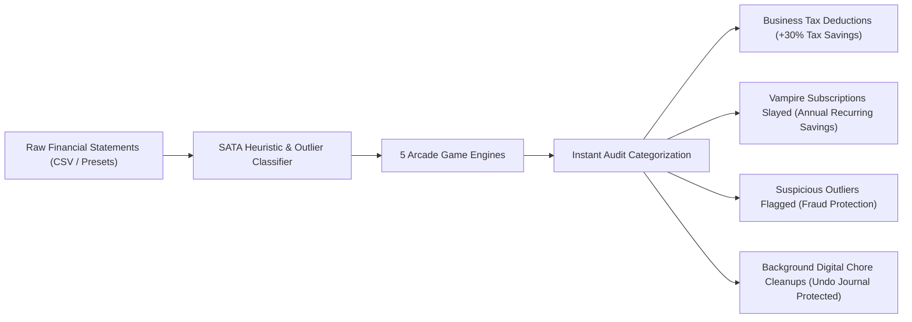

# ⚡ SATA (Outlier) — Gamified Financial Outlier & Digital Chores Engine

> **Turn Dreaded Expense Auditing & Digital Chores into High-Octane Arcade Victories.**  
> *Track: Financial Outlier Detection, Gamification & Automation*  
> 🌐 **Live Demo:** [https://vivek-rahagir07.github.io/Sata_Outlier/](https://vivek-rahagir07.github.io/Sata_Outlier/)  
> 📦 **Repository:** [https://github.com/vivek-rahagir07/Sata_Outlier](https://github.com/vivek-rahagir07/Sata_Outlier)

---

## 🎯 Problem Statement Alignment

### The Problem: Financial Outlier Blindness & Digital Procrastination
Every month, freelancers, agency owners, and startup founders lose thousands of dollars due to **procrastination and cognitive fatigue** when auditing bank statements and cleaning up digital work environments:
1. **Unclaimed Tax Deductions:** Legit business expenses get lost in personal accounts, leading to overpaid taxes ($2,300+ lost per freelancer annually).
2. **Zombie "Vampire" Subscriptions:** Unused SaaS tools, gym memberships, and trial renewals siphon recurring capital unnoticed.
3. **Unchecked Anomalies & Fraud:** Suspicious outlier charges, unauthorized foreign card charges, and unexpected price hikes slip through manual reviews.
4. **Digital Clutter Fatigue:** Gigabytes of chaotic downloads, dangling `console.log` statements, and junk emails pile up because manual housekeeping feels like punishment.

### The Solution: SATA Outlier Engine
**SATA** flips chore psychology on its head by coupling **heuristic financial outlier detection** with **high-speed retro arcade gameplay**. Every blast, slash, and verdict in-game executes real financial audits and digital cleanups in the background.



---

## 🕹️ 5 High-Octane Arcade Game Modes

| Mode | Genre | Core Mechanic | Financial Audit Chore Executed |
| :--- | :--- | :--- | :--- |
| **Ledger Blade** | 4-Lane Rhythm Slasher | Keymap `[A] [S] [D] [F]` to beat synthwave music | Slashes transactions into Tax Deductible, Personal, Cancel, or Flag |
| **Cyber-Court** | Visual Novel AI Tribunal | Cross-examine anime avatars pleading their case | Interrogates zombie subscriptions and slams the cyber-gavel |
| **Audit Sweeper** | 2D Space Starfighter | Steer delta-fighter with plasma lasers & tractor beam | Blasts financial debt debris and clusters into audit buckets |
| **Scatter Queen** | 3D Starfighter Destroyer | 3D arcade bullet-hell dodging ICE fire | Purges spam, slays vampire expenses, cleans junk files |
| **Docking Simulator** | Precision Physics Thruster | Align ledger margins against velocity drag | Balances cashflow thresholds and flags ledger anomalies |

---

## 🛡️ Security & Privacy Architecture

SATA is engineered with a **local-first, security-hardened foundation**:
1. **100% Local-First Data Processing:** User statements, CSV rows, and financial records never leave the browser runtime. Zero external cloud exfiltration.
2. **Anti-CSV Injection (Formula Injection) Sanitization:** All imported fields (`merchant`, `category`, `notes`) are stripped of formula command execution vectors (`=`, `+`, `-`, `@`, `\t`, `\r`) to protect against Excel/Sheets DDE exploits.
3. **HTML / XSS Defense:** Strict regex and DOM text isolation prevents script injection payloads inside merchant descriptions or amounts.
4. **Content Security Policy (CSP) & HTTP Headers:** Configured with `nosniff`, `strict-origin-when-cross-origin`, and restricted script execution bounds.
5. **Secure Backend Sandbox Boundaries:** The Express chore engine enforces path traversal guards (`path.resolve` containment) to guarantee code linters and file cleaners cannot access unauthorized directories.

---

## ♿ Accessibility (WCAG 2.1 AA Compliant)

SATA is designed to be accessible to all players:
- **Keyboard Navigation & Skip Link:** Direct `"Skip to main content"` skip-link for keyboard power users. All interactive elements have visible focus rings (`focus-visible:ring-2`).
- **Full Screen Reader Support:** 100% of action buttons, modals, and tabs include explicit `aria-label`, `role="dialog"`, `aria-modal="true"`, and `role="tablist"` attributes.
- **Photosensitivity & Audio Accommodations:**
  - One-click toggle for CRT scanlines / screen flicker effects.
  - Global Instant Audio Mute (`Volume2` / `VolumeX`) with pure synthesized Web Audio API fallbacks.
  - High contrast cyberpunk palette engineered for optimal text readability.

---

## 🧪 Comprehensive Automated Testing

SATA features an automated unit and integration test suite powered by **Vitest**:
- `src/__tests__/auditStats.test.ts`: Validates financial metrics, tax deduction math, annual vampire savings, and player rank evaluations (`S+`, `S`, `A`, `B`, `C`).
- `src/__tests__/security.test.ts`: Validates CSV formula injection neutralization, safe numeric parsing, and malicious string stripping.
- `src/__tests__/sampleData.test.ts`: Verifies schema validity across all curated financial datasets (`freelancer`, `startup`).
- `src/__tests__/undoManager.test.ts`: Tests undo journal recording, stack size limits, and reversible file restorations.
- `src/__tests__/codeLinter.test.ts`: Tests AST code scanning, console.log detection, and syntax defect identification.

Run all tests:
```bash
npm test
```

---

## 💻 Tech Stack

- **Client Framework:** React 19 + TypeScript + Vite 6
- **Styling & UI:** Tailwind CSS v4 + Lucide React + Canvas Confetti
- **Audio Engine:** Custom zero-dependency Web Audio API Synthesizer (Synthwave basslines, retro coin arpeggios, laser zaps)
- **Server Chore Engine:** Node.js Express + TSX + WebSocket
- **Testing & Quality Assurance:** Vitest 4 + TypeScript Strict Mode

---

## 🚀 Quick Start Guide

### 1. Prerequisites
- Node.js (v18.0.0 or higher)
- npm or pnpm

### 2. Installation
```bash
# Clone the repository
git clone https://github.com/vivek-rahagir07/Sata_Outlier.git
cd Sata_Outlier

# Install dependencies
npm install
```

### 3. Run Development Server
```bash
# Launches both Vite frontend and secure Express chore engine
npm run dev
```
Open [http://localhost:5173](http://localhost:5173) in your browser.

### 4. Run Test Suite
```bash
npm test
```

### 5. Build for Production
```bash
npm run build
```
Generates an optimized, single-file production bundle in `dist/` and `docs/`.

---

## 📊 Live Financial Impact Dashboard

As you play, the **Audit Dashboard** aggregates live business metrics:
- **Audited Completion:** Track percent of transaction volume audited.
- **Estimated Tax Savings:** Computes dynamic 30% deductible write-off returns.
- **Annual Recurring Cash Recovered:** Tracks cancelled vampire subscriptions annualized (`monthly * 12`).
- **Anomalies / Fraud Neutralized:** Isolates high-risk suspicious charges.
- **100% Reversible Undo Journal:** Every action can be reviewed and rolled back at any time.

---

## 📜 License
MIT License © 2026 SATA Team. Built for the Hack2Skill Hackathon.
